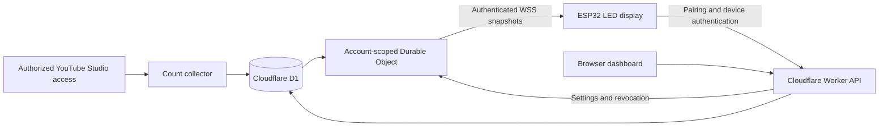

# SubCounter

## Connecting a physical subscriber display to YouTube Studio

I built the cloud backend, account dashboard, and ESP32 firmware that connect a physical LED counter to an authorized YouTube Studio channel. The dashboard manages channels, pairs counters, and controls each display's color, brightness, and power.

The interesting engineering problem is keeping an intermittently connected device useful while coordinating account ownership, an upstream data source, and several displays that may share one channel.

[SubCounter storefront](https://subcounter.app/) · [Account dashboard](https://my.subcounter.app/)

## Architecture

## Languages by component

| Component | Languages | Platform |
| --- | --- | --- |
| **Physical display firmware** | **C++** | ESP32, Arduino, FreeRTOS |
| **Backend and device APIs** | **JavaScript** | Cloudflare Workers, Durable Objects, WebSockets |
| **Browser dashboard** | **HTML, CSS, JavaScript** | Browser UI served by Cloudflare |
| **Database** | **SQL** | D1 / SQLite |
| Development tools | Python, Shell | Build and verification scripts |

Google sign-in identifies the SubCounter account. The collector uses separately authorized YouTube Studio Viewer access to obtain channel counts, with its own session and reconnection handling.

## Decisions that matter

### Share upstream work across displays

Several counters can belong to the same account and channel. A conditional database lease prevents concurrent requests from duplicating a due source collection. Collection is normally scheduled around a ten-second minimum interval while displays are active, with backoff when the source fails. The account's Durable Object coordinates delivery and uses WebSocket hibernation.

### Reconnect with complete state

Every new device connection receives a complete snapshot of the count, presentation settings, and source status. Stream identifiers and sequence numbers let the firmware reject obsolete or out-of-order messages. A device that misses updates catches up with current state instead of depending on a replay of every intermediate message.

### Keep the physical display useful offline

The ESP32 renders its saved count before networking starts and retains that value during a connection failure. Zero and subscriber decreases are valid; a missing source value does not erase a known count. Network work runs separately from LED rendering, and persistent writes are limited to reduce flash wear.

### Treat pairing as an ownership boundary

Each counter generates its own credential. The backend keeps its hash, and authenticated account checks control pairing and channel assignment. Appearance controls are independent for each device. Credential revocation also applies to existing socket connections.

## What I implemented

- The multi-account backend, D1 schema, source collection, and device APIs.
- Account-scoped WebSocket delivery, shared collection work, reconnect behavior, and stale-source reporting.
- The browser dashboard, Google sign-in, channel setup, counter pairing, and appearance presets.
- ESP32 Wi-Fi onboarding, protocol/state handling, offline caching, LED behavior, and subscriber animations.
- Signed firmware-update verification and automated backend/native-firmware integration checks.

## Validation and current limits

The test tooling exercises account isolation, concurrent pairing, credential revocation, reconnect snapshots, count retention, zero/decreasing values, and per-device settings. Integration checks use disposable workerd/SQLite and the compiled firmware protocol/cache/LED logic with synthetic counts.

The project remains under development. Automatic customer invitation activation, phone captive-portal transitions, and physical update/recovery behavior require further validation. Delivery timing depends on source availability, collection cadence, network conditions, and any active display animation. Electrical and radio behavior require physical testing.

The application and firmware source are maintained in a private repository. This public case study describes the architecture and my contribution without publishing the commercial implementation or account data.
